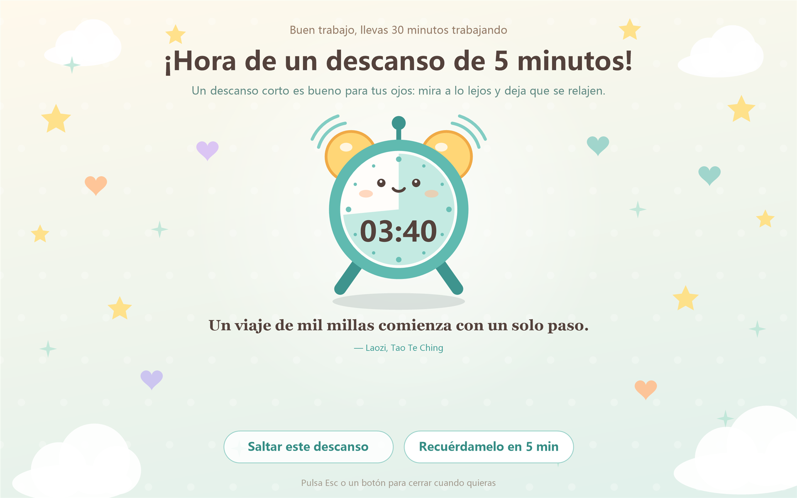

# Break Reminder: reloj despertador para descansar ⏰

[English](README.md) · [简体中文](README.zh-CN.md) · **Español**

Un reloj despertador amable, a pantalla completa, que te recuerda descansar. Cada 30 minutos cubre tu pantalla
con una cuenta atrás de 5 minutos, un consejo de salud y una cita que te anima. Gratis, de código abierto, solo para
Windows y se instala con un solo comando.



## Por qué lo hice

Paso muchas horas al día frente al ordenador y siempre se me olvidaba levantarme, estirarme y tomar un poco de aire
fresco. Una notificación pequeña en la esquina de la pantalla era demasiado fácil de ignorar. Quería algo que de verdad
me *interrumpiera*, pero con cariño: un reloj bonito a pantalla completa, una razón para descansar y una frase amable.
Así que lo creé y lo comparto gratis, por si también te sirve.

## Por qué descansar te hace bien

Una pausa de cinco minutos cada media hora es un hábito pequeño con beneficios reales:

- **Tus ojos.** Los profesionales del cuidado visual (por ejemplo, la Asociación Optométrica Americana) recomiendan la
  «regla 20-20-20»: cada 20 minutos, mira algo a unos 6 metros (20 pies) durante 20 segundos. Frente a la pantalla
  parpadeamos menos y los ojos se cansan.
- **Tu circulación y tu cuerpo.** Organismos de salud como la OMS aconsejan limitar los periodos largos sin
  interrupción sentado. Levantarte y caminar activa la circulación de la sangre y relaja el cuello, los hombros y la espalda.
- **Tu mente.** Las pausas cortas te ayudan a mantener la concentración y la creatividad, y alivian el estrés.
  Respira hondo unas veces, bebe agua, mira por la ventana.

*Esta es información general de bienestar, no un consejo médico.*

## Descarga gratuita

Es **100 % gratis** y de código abierto con licencia MIT. Sin cuenta, sin anuncios, sin rastreo.

1. En esta página, haz clic en el botón verde **Code** y luego en **Download ZIP**.
2. Haz clic derecho en el ZIP descargado y elige **Extraer todo**.

(Si usas git: `git clone https://github.com/yongxincoco0308/break-reminder.git`)

## Cómo ponerlo en marcha

Necesitas Windows 10 u 11. No hay que instalar nada más.

1. Abre la carpeta extraída en el Explorador de archivos.
2. Haz clic en la barra de direcciones de la carpeta, escribe `powershell` y pulsa **Intro**. Se abre una ventana azul.
3. Copia una de estas líneas y pulsa **Intro**. Elige tu idioma:

```powershell
powershell -ExecutionPolicy Bypass -File .\install.ps1 -Language es
```

```powershell
powershell -ExecutionPolicy Bypass -File .\install.ps1 -Language en
```

```powershell
powershell -ExecutionPolicy Bypass -File .\install.ps1 -Language zh
```

Listo. El recordatorio funciona en segundo plano y **se inicia solo cada vez que inicias sesión en Windows**.
El primer descanso aparece a los 30 minutos.

¿Quieres verlo ya? Ejecuta esto (muestra un descanso y se cierra):

```powershell
powershell -ExecutionPolicy Bypass -File .\break-reminder.ps1 -TestNow -Language es
```

Si no eliges idioma, usa el idioma de pantalla de tu Windows (chino, español o, en otro caso, inglés).

## Cómo pausarlo

Abre PowerShell otra vez en la carpeta (pasos 1 y 2 de arriba) y ejecuta:

| Quiero… | Ejecuta esto |
|---|---|
| **Pausar por ahora** (vuelve en tu próximo inicio de sesión) | `powershell -ExecutionPolicy Bypass -File .\pause.ps1` |
| **Pausar hasta que yo diga** (tampoco se inicia solo) | `powershell -ExecutionPolicy Bypass -File .\pause.ps1 -Disable` |
| **Reanudar** | `powershell -ExecutionPolicy Bypass -File .\resume.ps1` |

Para saltarte un solo descanso, pulsa **Esc** en la pantalla de descanso o haz clic en **Saltar este descanso**.
Con **Recuérdamelo en 5 min** lo aplazas cinco minutos.

## Cómo eliminarlo por completo

1. Abre PowerShell en la carpeta y ejecuta:

```powershell
powershell -ExecutionPolicy Bypass -File .\uninstall.ps1
```

2. Borra la carpeta. No queda nada más en tu ordenador.

*¿Prefieres hacer clic?* Abre el **Programador de tareas** desde el menú Inicio, busca **BreakReminder** en la
Biblioteca del Programador de tareas, haz clic derecho y elige **Finalizar**, **Deshabilitar** o **Eliminar**.

## Ajustes

Añade opciones al comando de instalación. Por ejemplo, ciclos de trabajo de 45 minutos con descansos de 10 en español:

```powershell
powershell -ExecutionPolicy Bypass -File .\install.ps1 -Language es -WorkMinutes 45 -BreakMinutes 10
```

| Opción | Significado | Valor por defecto |
|---|---|---|
| `-Language` | `es`, `en` o `zh` | el idioma de tu Windows |
| `-SecondLanguage` | muestra también la cita en un segundo idioma (p. ej. `en`) | ninguno |
| `-WorkMinutes` | minutos de trabajo entre descansos | 30 |
| `-BreakMinutes` | duración del descanso | 5 |
| `-SnoozeMinutes` | cuánto aplaza «Recuérdamelo» | 5 |

Si vuelves a ejecutar `install.ps1`, simplemente reemplaza los ajustes anteriores.

## Las citas

Incluye 50 citas de pensadores, escritores y poetas (Laozi, Confucio, Séneca, Marco Aurelio, Mandela, Helen Keller,
Rilke, Winnie the Pooh y más), en chino, inglés y español. Cambian cada 40 segundos y, tras reiniciar, continúan donde
se quedaron. Edita `quotes.json` para añadir las tuyas.

El texto en inglés de las citas occidentales se comprobó con Wikiquote. Las traducciones entre idiomas son mías y sirven
de guía; si ves algún error, abre un issue.

## Privacidad

Funciona sin conexión. No recopila ni envía nada. Lo único que guarda es un archivo diminuto con el número de la última
cita mostrada, en `%LOCALAPPDATA%\BreakReminder` (lo borra `uninstall.ps1`).

## Licencia

Código: [MIT](LICENSE). Las citas pertenecen a sus autores originales.
