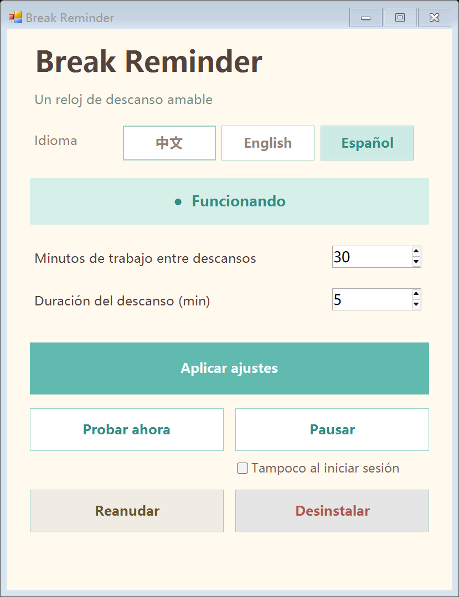

# Break Reminder: reloj despertador para descansar ⏰

[English](README.md) · [简体中文](README.zh-CN.md) · **Español**

Un reloj despertador amable, a pantalla completa, que te recuerda descansar. Cada 30 minutos cubre tu pantalla con una cuenta atrás de 5 minutos, un consejo de salud y una cita que te anima. Gratis, de código abierto, para Windows y Mac. Cambia entre English, 中文 y Español con un clic.

<h2 align="center"><a href="https://github.com/yongxincoco0308/break-reminder/archive/refs/heads/main.zip"><ins>Descargar</ins></a></h2>


## Por qué lo hice

Paso muchas horas frente al ordenador y, cuando estoy en plena faena, no paro.

Con el tiempo el cuerpo se queja: se me cargan los hombros, los ojos se me resecan y me duelen, y la mano se resiente por el ratón. En general, termino con el cuerpo molido.

Me he dado cuenta de que, después de un rato trabajando en interior, salir a respirar aire fresco y estirarme un poco me recarga las pilas mucho más que seguir a base de aguantar. Así puedo mantener el ritmo mucho más tiempo sin quemarme.

El problema es que siempre se me olvida. Una notificación diminuta en la esquina de la pantalla la descarto sin ni mirarla. Así que hice algo que, cuando toca, ocupa toda la pantalla, me obliga a parar de verdad y me dice algo bonito.

Ahora lo uso todos los días y lo comparto por si a ti también te sirve.

## Por qué descansar te hace bien

Una pausa de cinco minutos cada media hora es un hábito pequeño con beneficios reales:

- **Tus ojos.** Los profesionales del cuidado visual (por ejemplo, la Asociación Optométrica Americana) recomiendan la «regla 20-20-20»: cada 20 minutos, mira algo a unos 6 metros (20 pies) durante 20 segundos. Frente a la pantalla parpadeamos menos y los ojos se cansan.
- **Tu circulación y tu cuerpo.** Organismos de salud como la OMS aconsejan limitar los periodos largos sin interrupción sentado. Levantarte y caminar activa la circulación de la sangre y relaja el cuello, los hombros y la espalda.
- **Tu mente.** Las pausas cortas te ayudan a mantener la concentración y la creatividad, y alivian el estrés. Respira hondo unas veces, bebe agua, mira por la ventana.

*Esta es información general de bienestar, no un consejo médico.*

## Descarga gratuita

Es **100 % gratis** y de código abierto (licencia MIT). Sin cuenta, sin anuncios, sin rastreo.

**Pulsa [Descargar](https://github.com/yongxincoco0308/break-reminder/archive/refs/heads/main.zip)** (el mismo enlace está arriba, al principio de la página). Tu navegador descarga un archivo llamado `break-reminder-main.zip`. Después:

1. **Busca el archivo.** Púlsalo en la barra de descargas del navegador o abre tu carpeta **Descargas**.
2. **Descomprímelo.** En Windows: clic derecho en el archivo → **Extraer todo** → **Extraer**; la carpeta descomprimida se abre sola. En Mac: doble clic en el archivo; la carpeta aparece a su lado.
3. En esa carpeta verás `Break Reminder (Windows).bat` (Windows) o `Break Reminder (Mac).command` (Mac). Ese es el que debes abrir con doble clic, como se explica abajo.
## Empezar en Windows

No hay que escribir ningún comando y no hace falta instalar nada más.

1. En la carpeta que se acaba de abrir, **haz doble clic en `Break Reminder (Windows).bat`**.
   - Windows puede mostrar una ventana azul «Windows protegió su PC» o preguntar «¿Quieres ejecutar este archivo?». Pulsa **Más información → Ejecutar de todas formas** (o **Ejecutar**). Aparece con cualquier archivo de internet que no esté firmado digitalmente. Los scripts son texto plano, así que puedes abrirlos y leerlos antes.
2. Se abre esta ventana pequeña:

   

3. Pulsa el botón verde grande, **Iniciar el recordatorio**. Ya está.

Ahora funciona en segundo plano y **se inicia solo cada vez que inicias sesión en Windows**. El primer descanso aparece a los 30 minutos. ¿Quieres verlo ya? Pulsa **Probar ahora**.

## Empezar en Mac (beta)

1. **Instala Python una sola vez** (gratis): descarga el instalador para macOS de https://www.python.org/downloads/macos/, ábrelo y sigue pulsando *Continuar*. Incluye lo que necesita esta aplicación.
2. En la carpeta descomprimida, **haz doble clic en `Break Reminder (Mac).command`**. La primera vez, macOS puede decir que no se puede abrir porque es de un desarrollador no identificado. Entonces **clic derecho en el archivo → Abrir → Abrir**.
3. Aparece un menú con opciones numeradas. Elige **1. Iniciar / aplicar ajustes** y responde a las dos preguntas.

Esta versión es una **beta**: el aspecto y la lógica están probados, pero la parte de inicio automático todavía no se ha probado en un Mac real, así que abre un issue si algo no funciona. Mientras funciona puede aparecer un pequeño icono de Python en el Dock, y la pantalla completa solo cubre tu pantalla principal.

## Cambiar de idioma

No hace falta decidirlo al instalar. En la pantalla de descanso, haz clic en **中文 · English · Español** en la **esquina superior derecha**. La página cambia al instante y se recuerda tu elección. En Windows también puedes elegir el idioma en el panel de control. Por defecto usa el idioma de tu ordenador.

## Pausar, reanudar o eliminar (paso a paso)

Todo esto se hace en la **misma ventana con la que lo iniciaste**. Primero, vuelve a abrir esa ventana:

- **Windows:** abre la carpeta que descomprimiste (`break-reminder-main`, normalmente dentro de **Descargas**) y haz doble clic en **`Break Reminder (Windows).bat`**. Se abre la ventana pequeña de la imagen de arriba. La barra de arriba te dice qué está pasando: **verde = funcionando**, **amarillo = en pausa**, **gris = sin instalar**.
- **Mac:** abre la carpeta que descomprimiste (`break-reminder-main`, normalmente dentro de **Descargas**) y haz doble clic en **`Break Reminder (Mac).command`**. Se abre un menú con opciones numeradas (de 1 a 7). Elige una y pulsa **OK**.

Después sigue la parte que necesites:

### Quiero pausarlo un rato (por ejemplo, en una reunión)

- **Windows:** pulsa **Pausar**. La barra se pone amarilla. Volverá a empezar **solo** la próxima vez que inicies sesión en Windows.
- **Mac:** elige **3. Pausar**.

### Quiero que siga apagado hasta que yo lo encienda

- **Windows:** primero marca la casilla **Tampoco al iniciar sesión** y luego pulsa **Pausar**.
- **Mac:** elige **4. Pausar hasta reanudar**.

### Quiero volver a encenderlo

- **Windows:** pulsa **Reanudar**. La barra vuelve a ponerse verde.
- **Mac:** elige **5. Reanudar**.

### Quiero eliminarlo por completo

1. Vuelve a abrir la ventana (mira arriba).
2. **Windows:** pulsa **Desinstalar** y luego **Sí**. **Mac:** elige **7. Desinstalar** y luego **Yes**.
3. Ahora borra la carpeta `break-reminder-main` (clic derecho → **Eliminar**).

**Haz el paso 2 antes del paso 3.** Si borras la carpeta primero, queda en tu ordenador una pequeña entrada de inicio. Si ya ha pasado: descarga el proyecto otra vez, descomprímelo, abre la ventana y pulsa **Desinstalar**; después borra la carpeta.

### ¿Cómo sé si está funcionando?

Abre la ventana. En Windows la barra muestra **Funcionando** en verde. En Mac elige **6. ¿Funciona?**.

### Solo quiero saltarme un descanso

En la pantalla completa de descanso, pulsa el texto pequeño **Saltar este descanso** que hay bajo el botón grande (o la tecla **Esc**). El botón grande, **Recuérdamelo en 5 min**, aplaza el descanso cinco minutos.

## Ajustes

En el panel de control (en Mac: la primera opción del menú) puedes cambiar los minutos de trabajo entre descansos (por defecto 30) y la duración de cada descanso (por defecto 5), y pulsar **Aplicar ajustes**.

<details>
<summary>Para usuarios avanzados: línea de comandos</summary>

```powershell
powershell -ExecutionPolicy Bypass -File .\install.ps1 -WorkMinutes 45 -BreakMinutes 10 -SnoozeMinutes 5
```

En Mac: `bash macos/install.sh --work 45 --break 10 --snooze 5`.
Opciones extra: `-Language en|zh|es` fija el idioma inicial; `-SecondLanguage` muestra además cada cita en un segundo idioma. Scripts: `pause.ps1`, `resume.ps1`, `uninstall.ps1` (Windows) y `pause.sh`, `resume.sh`, `uninstall.sh`, `status.sh` (Mac).

</details>

## Las citas

Incluye 50 citas, y cada una muestra su fuente (autor y obra):

- 20 de clásicos y poesía chinos (Laozi, Confucio, Tao Yuanming, Li Bai y más)
- 14 de escritores occidentales (Séneca, Marco Aurelio, Mandela, Rilke, Winnie the Pooh y más)
- 14 de escritores en español (Machado, Cervantes, Martí, Neruda y más)
- 2 mensajes cortos de una galleta de la fortuna

Todas están en chino, inglés y español. Cambian cada 40 segundos y, tras reiniciar, continúan donde se quedaron. Edita `quotes.json` para añadir las tuyas.

El texto y las fuentes de las citas occidentales se comprobaron con Wikiquote. En las citas chinas y de escritores en español comprobé las fuentes que pude, pero no todas, y las traducciones entre idiomas son mías y sirven de guía. Si ves algún error, abre un issue.

## Privacidad

Funciona sin conexión. No recopila ni envía nada. Solo guarda dos archivos diminutos (el número de la última cita mostrada y tu idioma elegido) en `%LOCALAPPDATA%\BreakReminder` en Windows, o en `~/Library/Application Support/BreakReminder` en Mac. **Desinstalar** los borra.

## Licencia

Código: [MIT](LICENSE). Las citas pertenecen a sus autores originales.
