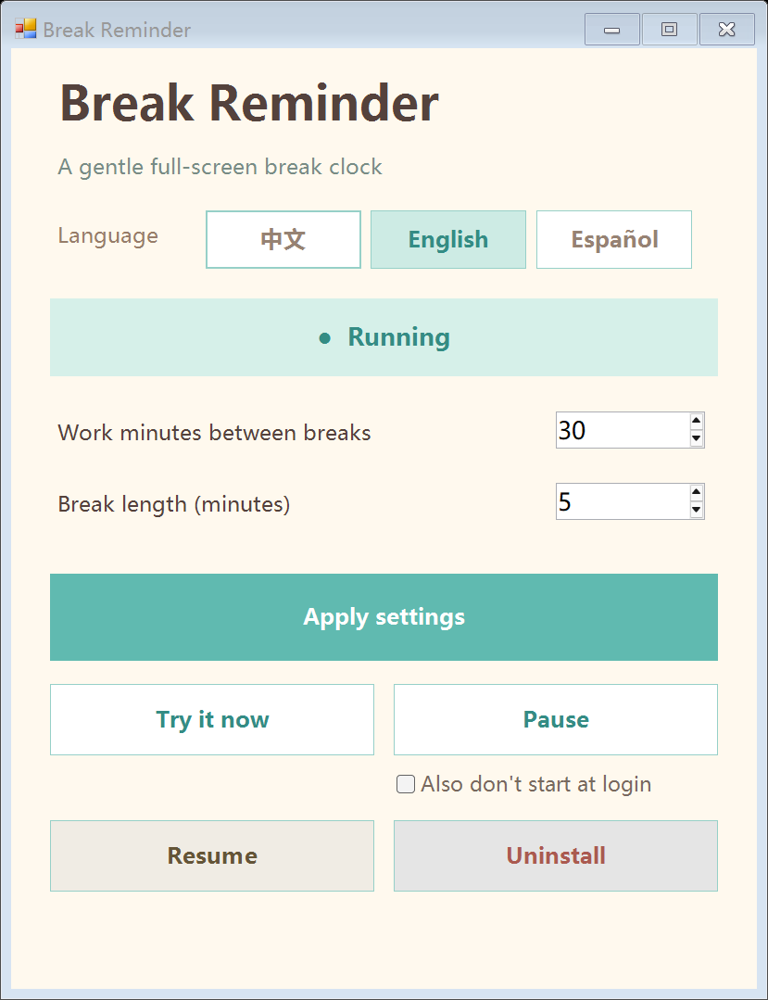

# Break Reminder ⏰

**English** · [简体中文](README.zh-CN.md) · [Español](README.es.md)

A gentle full-screen alarm clock that makes you take a break. Every 30 minutes it covers your screen with a
5-minute countdown, a short health tip, and an encouraging quote. Free, open source, for Windows and Mac.
Switch between English, 中文 and Español with one click.

<h2 align="center"><a href="https://github.com/yongxincoco0308/break-reminder/archive/refs/heads/main.zip"><u>Download</u></a></h2>


## Why I made this

I spend a lot of hours at my computer, and when I'm busy I just don't stop.

After a while my body starts complaining: my shoulders ache, my eyes get dry and sore, and my hand gets that mouse-hand strain. Overall I just feel worn down.

What I noticed is that after a stretch of working indoors, stepping outside for some fresh air and a bit of stretching recharges me way more than pushing through. It helps me keep going for the long haul instead of burning out.

The problem is, I always forget. A tiny notification in the corner of the screen? I swipe it away without even looking. So I built something that takes over the whole screen when it's time, makes me actually stop, and says something kind while it does.

I use it every day now, and I'm sharing it in case it helps you too.

## Why taking breaks is good for you

A five-minute pause every half hour is a small habit with real benefits:

- **Your eyes.** Eye-care professionals (for example the American Optometric Association) recommend the "20-20-20 rule": every 20 minutes, look at something about 6 metres (20 feet) away for 20 seconds. Staring at a screen makes us blink less and strains our eyes.
- **Your blood flow and body.** Health organisations such as the WHO advise limiting long, unbroken periods of sitting. Standing up and walking around gets your circulation going and relaxes your neck, shoulders and back.
- **Your mind.** Short breaks help you stay focused and creative, and ease stress. Take a few deep breaths, drink some water, look out of the window.

*This is general wellness information, not medical advice.*

## Free download

It is **100% free** and open source (MIT license). No account, no ads, no tracking.

**Click [Download](https://github.com/yongxincoco0308/break-reminder/archive/refs/heads/main.zip)** (the same link is at the top of this page). Your browser downloads a file called `break-reminder-main.zip`. Then:

1. **Find the file.** Click it in your browser's download bar, or open your **Downloads** folder.
2. **Unzip it.** On Windows, right-click the file → **Extract All** → **Extract**; the unzipped folder opens by itself. On a Mac, double-click the file; the folder appears next to it.
3. In that folder you will see a file called `Break Reminder (Windows).bat` (Windows) or `Break Reminder (Mac).command` (Mac). That is the one you double-click, as described below.
## Get started on Windows

You don't need to type any commands, and nothing else needs to be installed.

1. In the folder that just opened, **double-click `Break Reminder (Windows).bat`**.
   - Windows may show a blue "Windows protected your PC" window, or ask "Do you want to run this file?". Click **More info → Run anyway** (or **Run**). This appears for any file from the internet that isn't digitally signed. The scripts are plain text, so you can open and read them first.
2. This small window opens:

   

3. Click the big green button, **Start the reminder**. That's it.

It now runs quietly in the background and **starts by itself every time you sign in to Windows**. The first break appears after 30 minutes. Want to see it right away? Click **Try it now**.

## Get started on Mac (beta)

1. **Install Python once** (free): download the macOS installer from https://www.python.org/downloads/macos/, open it and keep clicking *Continue*. It includes what this app needs.
2. In the unzipped folder, **double-click `Break Reminder (Mac).command`**. The first time, macOS may say it can't be opened because it is from an unidentified developer. Then **right-click the file → Open → Open**.
3. A menu with numbered choices appears. Choose **1. Start / apply settings** and answer the two questions.

This version is a **beta**: the look and the logic were tested, but the start-at-login part has not yet been tested on a real Mac, so please open an issue if something doesn't work. A small Python icon may show in the Dock while it runs, and the full-screen page covers your main display only.

## Change the language

You don't have to decide when you install. On the break screen, click **中文 · English · Español** in the **top-right corner**. The page switches instantly, and your choice is remembered for next time. On Windows you can also pick the language in the control panel. By default it follows your computer's language.

## Pause, resume or delete it (step by step)

You do all of this from the **same window you used to start it**. First, open that window again:

- **Windows:** open the folder you unzipped (`break-reminder-main`, usually inside your **Downloads** folder) and double-click **`Break Reminder (Windows).bat`**. The small window from the picture above opens. The bar near the top tells you what is happening: **green = running**, **yellow = paused**, **grey = not installed**.
- **Mac:** open the folder you unzipped (`break-reminder-main`, usually inside your **Downloads** folder) and double-click **`Break Reminder (Mac).command`**. A menu opens with numbered choices (1 to 7). Pick one and press **OK**.

Then follow the part you need:

### I want to pause it for a while (for example during a meeting)

- **Windows:** click **Pause**. The bar turns yellow. It will start again **by itself** the next time you sign in to Windows.
- **Mac:** choose **3. Pause**.

### I want it to stay off until I turn it on myself

- **Windows:** first tick the small box **Also don't start at login**, then click **Pause**.
- **Mac:** choose **4. Pause until I resume**.

### I want to turn it back on

- **Windows:** click **Resume**. The bar turns green again.
- **Mac:** choose **5. Resume**.

### I want to delete it completely

1. Open the window again (see above).
2. **Windows:** click **Uninstall**, then **Yes**. **Mac:** choose **7. Uninstall**, then **Yes**.
3. Now delete the `break-reminder-main` folder (right-click it → **Delete**).

**Do step 2 before step 3.** If you delete the folder first, a small start-up entry stays on your computer. If that already happened: download the project again, unzip it, open the window and click **Uninstall**, then delete the folder.

### How can I tell it's running?

Open the window. On Windows the bar shows a green **Running**. On Mac choose **6. Is it running?**.

### I only want to skip one break

On the full-screen break page, click the small **Skip this break** under the big button (or press **Esc**). The big button, **Remind me in 5 min**, postpones the break by five minutes instead.

## Settings

In the control panel (Mac: the first menu choice) you can change how many minutes you work between breaks (default 30) and how long each break lasts (default 5), then click **Apply settings**.

<details>
<summary>For advanced users: command line</summary>

```powershell
powershell -ExecutionPolicy Bypass -File .\install.ps1 -WorkMinutes 45 -BreakMinutes 10 -SnoozeMinutes 5
```

On Mac: `bash macos/install.sh --work 45 --break 10 --snooze 5`.
Extra options: `-Language en|zh|es` sets the starting language; `-SecondLanguage` also shows each quote in a second language. Scripts: `pause.ps1`, `resume.ps1`, `uninstall.ps1` (Windows) and `pause.sh`, `resume.sh`, `uninstall.sh`, `status.sh` (Mac).

</details>

## The quotes

There are 50 quotes, and each one is shown with its source (author and work):

- 20 from Chinese classics and poetry (Laozi, Confucius, Tao Yuanming, Li Bai and more)
- 14 from Western writers (Seneca, Marcus Aurelius, Mandela, Rilke, Winnie-the-Pooh and more)
- 14 from Spanish-language writers (Machado, Cervantes, Martí, Neruda and more)
- 2 short messages from a fortune cookie

Every quote is available in Chinese, English and Spanish. They rotate every 40 seconds and carry on where they left off after a restart. Edit `quotes.json` to add your own.

The wording and sources of the Western quotes were checked against Wikiquote. For the Chinese and Spanish-language quotes I checked as many sources as I could, but not every one, and the translations between languages are my own and meant as a friendly guide. Please open an issue if you spot a mistake.

## Privacy

It works fully offline. It collects nothing and sends nothing. The only things it saves are two tiny files (the number of the last quote shown, and your chosen language) in `%LOCALAPPDATA%\BreakReminder` on Windows, or `~/Library/Application Support/BreakReminder` on Mac. **Uninstall** removes them.

## License

Code: [MIT](LICENSE). The quotes belong to their original authors.
