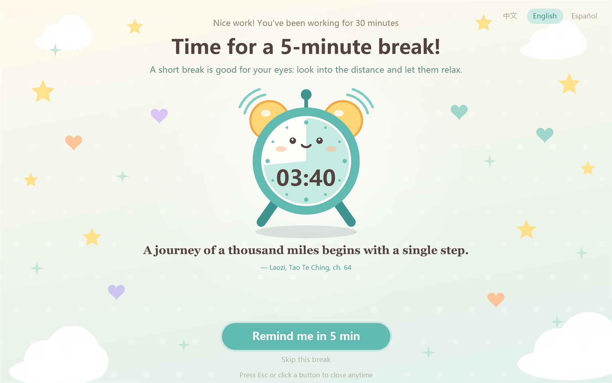

# Break Reminder ⏰

**English** · [简体中文](README.zh-CN.md) · [Español](README.es.md)

A gentle, full-screen alarm clock that makes you take a break. Every 30 minutes it covers your screen with a
5-minute countdown, a short health tip, and an encouraging quote. Free, open source, Windows only, no install needed beyond one command.



## Why I made this

I spend a lot of hours at my computer, and when I'm busy I just don't stop.

After a while my body starts complaining: my shoulders ache, my eyes get dry and sore, and my hand gets that mouse-hand strain. Overall I just feel worn down.

What I noticed is that after a stretch of working indoors, stepping outside for some fresh air and a bit of stretching recharges me way more than pushing through. It helps me keep going for the long haul instead of burning out.

The problem is, I always forget. A tiny notification in the corner of the screen? I swipe it away without even looking. So I built something that takes over the whole screen when it's time, makes me actually stop, and says something kind while it does.

I use it every day now, and I'm sharing it in case it helps you too.

## Why taking breaks is good for you

A five-minute pause every half hour is a small habit with real benefits:

- **Your eyes.** Eye-care professionals (for example the American Optometric Association) recommend the
  "20-20-20 rule": every 20 minutes, look at something about 6 metres (20 feet) away for 20 seconds.
  Staring at a screen makes us blink less and strains our eyes.
- **Your blood flow and body.** Health organisations such as the WHO advise limiting long, unbroken periods of
  sitting. Standing up and walking around gets your circulation going and relaxes your neck, shoulders and back.
- **Your mind.** Short breaks help you stay focused and creative, and ease stress. Take a few deep breaths,
  drink some water, look out of the window.

*This is general wellness information, not medical advice.*

## Free download

It is **100% free** and open source under the MIT license. No account, no ads, no tracking.

1. On this page, click the green **Code** button, then **Download ZIP**.
2. Right-click the downloaded ZIP and choose **Extract All**.

(If you use git: `git clone https://github.com/yongxincoco0308/break-reminder.git`)

## How to start it

Requires Windows 10 or 11. Nothing else to install.

1. Open the extracted folder in File Explorer.
2. Click the folder's address bar, type `powershell`, and press **Enter**. A blue window opens.
3. Copy one line into it and press **Enter**. Pick your language:

```powershell
powershell -ExecutionPolicy Bypass -File .\install.ps1 -Language en
```

```powershell
powershell -ExecutionPolicy Bypass -File .\install.ps1 -Language zh
```

```powershell
powershell -ExecutionPolicy Bypass -File .\install.ps1 -Language es
```

That's it. The reminder now runs quietly in the background and **starts by itself every time you log in to
Windows**. The first break appears after 30 minutes.

Want to see it right now? Run this (it shows one break and exits):

```powershell
powershell -ExecutionPolicy Bypass -File .\break-reminder.ps1 -TestNow -Language en
```

If you don't choose a language, it follows your Windows display language (Chinese, Spanish, or English).

## How to pause it

Open PowerShell in the folder again (steps 1 and 2 above), then:

| I want to… | Run this |
|---|---|
| **Pause for now** (it comes back at your next login) | `powershell -ExecutionPolicy Bypass -File .\pause.ps1` |
| **Pause until I say so** (no auto-start either) | `powershell -ExecutionPolicy Bypass -File .\pause.ps1 -Disable` |
| **Resume** | `powershell -ExecutionPolicy Bypass -File .\resume.ps1` |

To skip just one break, press **Esc** on the break screen or click **Skip this break**.
Click **Remind me in 5 min** to postpone it by five minutes.

## How to delete it completely

1. Open PowerShell in the folder and run:

```powershell
powershell -ExecutionPolicy Bypass -File .\uninstall.ps1
```

2. Delete the folder. Nothing else is left on your computer.

*Prefer clicking?* Open **Task Scheduler** from the Start menu, find **BreakReminder** in the Task Scheduler
Library, then right-click it and choose **End**, **Disable** or **Delete**.

## Settings

Add options to the install command. For example, a 45-minute work cycle with a 10-minute break in Spanish:

```powershell
powershell -ExecutionPolicy Bypass -File .\install.ps1 -Language es -WorkMinutes 45 -BreakMinutes 10
```

| Option | Meaning | Default |
|---|---|---|
| `-Language` | `en`, `zh` or `es` | your Windows language |
| `-SecondLanguage` | also show the quote in a second language (e.g. `zh`) | none |
| `-WorkMinutes` | minutes of work between breaks | 30 |
| `-BreakMinutes` | length of the break | 5 |
| `-SnoozeMinutes` | what "Remind me" postpones by | 5 |

Running `install.ps1` again simply replaces your previous settings.

## The quotes

There are 50 quotes from thinkers, writers and poets (Laozi, Confucius, Seneca, Marcus Aurelius, Mandela,
Helen Keller, Rilke, Winnie-the-Pooh and more), in Chinese, English and Spanish. They rotate every 40 seconds
and carry on where they left off after a restart. Edit `quotes.json` to add your own.

The English wording of the Western quotes was checked against Wikiquote. The translations between languages are
my own and meant as a friendly guide, so please open an issue if you spot a mistake.

## Privacy

It works fully offline. It collects nothing and sends nothing. The only thing it saves is one tiny file with the
number of the last quote shown, in `%LOCALAPPDATA%\BreakReminder` (removed by `uninstall.ps1`).

## License

Code: [MIT](LICENSE). The quotes belong to their original authors.
