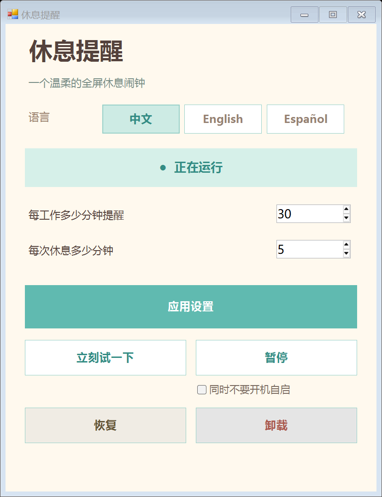

# 休息提醒闹钟 ⏰

[English](README.md) · **简体中文** · [Español](README.es.md)

一个温柔的全屏闹钟，提醒你好好休息。每工作 30 分钟，它会盖满整个屏幕，给你一个 5 分钟的倒计时、一条健康小提示和一句鼓励的名言。免费、开源，支持 Windows 和 Mac。中文、English、Español 一点就能切换。

<h2 align="center"><a href="https://github.com/yongxincoco0308/break-reminder/archive/refs/heads/main.zip"><u>下载</u></a></h2>


## 我为什么做这个

我每天对着电脑的时间特别长，一忙起来就停不下来。

时间一久，身体就开始抗议了：肩膀酸得不行，眼睛又干又痛，手也容易得鼠标手，整个人的状态都不太好。

后来我发现，在室内闷头干一阵之后，哪怕只是走到室外呼吸点新鲜空气、做做伸展，人恢复得特别快，像是把电量充回来了一样。这样工作反而能撑得更久，不用硬扛。

可我自己老是忘。屏幕角落那种小通知，我看都不看就划走了。所以我做了这个：到点就铺满整个屏幕，让我真的停下来，再配上一句暖心的话。

现在我自己天天在用。做出来了，也想分享给你，希望也能帮到你。

## 休息为什么对你好

每半小时停下来 5 分钟，是个小习惯，却有实实在在的好处：

- **对眼睛好。** 眼科专业人士（例如美国验光协会）推荐"20-20-20 法则"：每 20 分钟，看一眼大约 6 米（20 英尺）外的东西，持续 20 秒。盯着屏幕时我们眨眼变少，眼睛容易疲劳。
- **对血液循环和身体好。** 世界卫生组织等机构建议减少长时间不间断的久坐。站起来走一走，能促进血液循环，也能放松颈椎、肩膀和腰背。
- **对大脑好。** 短暂的休息能让你更专注、更有灵感，也能缓解压力。深呼吸几次、喝点水、看看窗外吧。

*以上是一般性的健康常识，不构成医疗建议。*

## 免费下载

它**完全免费**，使用 MIT 许可证开源。不用注册账号，没有广告，也不收集任何数据。

**点[下载](https://github.com/yongxincoco0308/break-reminder/archive/refs/heads/main.zip)**（本页最上面也有同样的链接）。浏览器会下载一个叫 `break-reminder-main.zip` 的文件。然后：

1. **找到这个文件。** 在浏览器的下载栏里点它，或者打开电脑的 **下载** 文件夹。
2. **解压。** Windows 上：在文件上右键 → **全部解压缩** → **解压**，解压好的文件夹会自动打开。Mac 上：双击这个文件，文件夹就出现在它旁边。
3. 在这个文件夹里，你会看到 `Break Reminder (Windows).bat`（Windows）或 `Break Reminder (Mac).command`（Mac）。双击它就行，具体看下面的步骤。
## 在 Windows 上开始用

不用输入任何命令，也不用再安装别的东西。

1. 在刚刚打开的文件夹里，**双击 `Break Reminder (Windows).bat`**。
   - Windows 可能会弹出蓝色的"Windows 已保护你的电脑"窗口，或者问你"是否要运行此文件"。点 **更多信息 → 仍要运行**（或者 **运行**）。任何从网上下载、没有数字签名的文件都会这样提示。这些脚本都是纯文本，你可以先打开看看。
2. 会打开下面这个小窗口：

   

3. 点那个绿色的大按钮 **开始提醒**，就好了。

它会在后台安静运行，而且**每次登录 Windows 都会自动启动**。第一次休息会在 30 分钟后出现。想马上看看效果？点 **立刻试一下**。

## 在 Mac 上开始用（测试版）

1. **先安装一次 Python**（免费）：到 https://www.python.org/downloads/macos/ 下载 macOS 安装包，打开后一路点"继续"。它自带这个程序需要的东西。
2. 在解压出来的文件夹里，**双击 `Break Reminder (Mac).command`**。第一次 macOS 可能会说"无法打开，因为来自身份不明的开发者"，这时**右键点这个文件 → 打开 → 打开**。
3. 会弹出一个带编号的菜单。选 **1. 开始 / 应用设置**，回答两个问题就行。

这个版本是**测试版**：画面和程序逻辑都测试过，但"登录时自动启动"这一部分还没有在真正的 Mac 上测试过，如果有问题，欢迎提 issue。运行时 Dock 里可能会出现一个小小的 Python 图标，全屏页面只会盖住主显示器。

## 切换语言

安装时不用先决定语言。在休息页面的**右上角**点 **中文 · English · Español**，整页立刻换成对应的语言，下次会记住你的选择。Windows 上也可以在控制面板里选语言。默认跟随你电脑的语言。

## 暂停、恢复、删除（一步一步来）

这些事都在**你开始用它时的同一个窗口**里做。先把那个窗口重新打开：

- **Windows：** 打开你解压出来的文件夹（`break-reminder-main`，通常在 **下载** 文件夹里），双击 **`Break Reminder (Windows).bat`**，就会出现上面图里的那个小窗口。窗口上方有一条状态栏，告诉你现在是什么情况：**绿色 = 正在运行**，**黄色 = 已暂停**，**灰色 = 还没安装**。
- **Mac：** 打开你解压出来的文件夹（`break-reminder-main`，通常在 **下载** 文件夹里），双击 **`Break Reminder (Mac).command`**，会弹出一个带编号（1 到 7）的菜单，选一项再点 **OK**。

然后看你想做的是哪一件：

### 我想先暂停一会儿（比如开会的时候）

- **Windows：** 点 **暂停**。状态栏会变成黄色。**下次你登录 Windows 时，它会自己重新启动。**
- **Mac：** 选 **3. 暂停**。

### 我想让它一直关着，直到我自己再打开

- **Windows：** 先勾上小方框 **同时不要开机自启**，再点 **暂停**。
- **Mac：** 选 **4. 一直暂停**。

### 我想重新打开它

- **Windows：** 点 **恢复**。状态栏又变回绿色。
- **Mac：** 选 **5. 恢复**。

### 我想彻底删除它

1. 先把窗口重新打开（见上面）。
2. **Windows：** 点 **卸载**，再点 **是**。**Mac：** 选 **7. 卸载**，再点 **Yes**。
3. 然后再删除 `break-reminder-main` 文件夹（右键点它 → **删除**）。

**一定要先做第 2 步，再做第 3 步。** 如果先删了文件夹，电脑里会留下一条开机自启的记录。万一已经这样了：重新下载一次项目、解压、打开那个窗口，点 **卸载**，再删文件夹就行。

### 怎么知道它在不在运行？

打开那个窗口。Windows 上状态栏是绿色的 **正在运行**；Mac 上选 **6. 它在运行吗？**。

### 我只想跳过这一次休息

在全屏的休息页面上，点大按钮下面那行小字 **跳过本次休息**（或按 **Esc**）。上面那个大按钮 **稍后 5 分钟再提醒**，则是把这次休息延后五分钟。

## 设置

在控制面板里（Mac 是菜单的第一项），可以改两次休息之间工作多少分钟（默认 30）、每次休息多少分钟（默认 5），再点 **应用设置**。

<details>
<summary>进阶：命令行用法</summary>

```powershell
powershell -ExecutionPolicy Bypass -File .\install.ps1 -WorkMinutes 45 -BreakMinutes 10 -SnoozeMinutes 5
```

Mac 上：`bash macos/install.sh --work 45 --break 10 --snooze 5`。
其他参数：`-Language en|zh|es` 设置初始语言；`-SecondLanguage` 让每句名言再显示第二种语言。脚本：`pause.ps1`、`resume.ps1`、`uninstall.ps1`（Windows），`pause.sh`、`resume.sh`、`uninstall.sh`、`status.sh`（Mac）。

</details>

## 关于名言

内置 50 条名言，每一条都标明了出处（作者和作品）：

- 20 条来自中国古籍和诗词（老子、孔子、陶渊明、李白等）
- 14 条来自西方作家（塞涅卡、马可·奥勒留、曼德拉、里尔克、小熊维尼等）
- 14 条来自西班牙语作家（马查多、塞万提斯、马蒂、聂鲁达等）
- 2 条来自幸运饼干的小话

每一条都有中文、英文、西班牙语三个版本。每 40 秒换一条，重启后接着上次的位置往下播。想加自己的？编辑 `quotes.json` 即可。

西方名言的原文和出处都对照 Wikiquote 核对过。中国古籍和西班牙语作家的出处，我尽量核对了，但不是每一条都核对过。不同语言之间的翻译是我自己翻译的，仅供参考。如发现错误，欢迎提 issue。

## 隐私

它完全离线运行，不收集也不上传任何东西。它只会保存两个很小的文件（上一次播放到第几条名言、你选的语言），Windows 上在 `%LOCALAPPDATA%\BreakReminder`，Mac 上在 `~/Library/Application Support/BreakReminder`。点 **卸载** 时会一并清除。

## 许可证

代码使用 [MIT](LICENSE) 许可证。名言的版权归原作者所有。
